# 🛡️ Awesome Threat Intelligence & Compromise Indicators (IOCs) 🎯

> 🔍 A curated directory of the best **Threat Intelligence Platforms (TIP)**, **Indicators of Compromise (IOC)** management systems, adversary profiling suites, and cyber threat intelligence (CTI) feeds — spanning enterprise SaaS solutions and open-source software. ⚡

  
  
  
  
  

---

## 📋 Table of Contents 📑

- [🌐 Sector Overview & Market Dynamics](#-sector-overview--market-dynamics)
- [🟦 SaaS / Hosted Platforms](#-saas--hosted-platforms)
- [🟩 Open-Source Software](#-open-source-software)
- [📊 Comparison at a Glance](#-comparison-at-a-glance)
- [⭐ Star History](#-star-history)
- [💖 Support & Sponsorship](#-support--sponsorship)
- [🤝 Contributing](#-contributing)
- [📄 License](#-license)

---

## 🌐 Sector Overview & Market Dynamics 📈

The global Cyber Threat Intelligence (CTI) market was valued at approximately **$5.5 billion in 2024** and is projected to expand to **$13.2 billion by 2030**, advancing at a compound annual growth rate (CAGR) of ~15.8%. 🚀

The sector is **moderately fragmented**; while hyper-scale tech conglomerates and consolidated cybersecurity giants (Microsoft, CrowdStrike, Palo Alto Networks, Cisco) capture substantial market share through all-in-one SOC suites and endpoint telemetry ecosystems, specialized pure-play intelligence vendors (Recorded Future, Mandiant, Flashpoint, Anomali, ThreatConnect) maintain durable defensibility through proprietary dark-web crawlers, exclusive incident response disclosures, and specialized human analytical tradecraft. 🕵️‍♂️

---

## 🟦 SaaS / Hosted Platforms ☁️

Below is a curated comparison of top commercial Threat Intelligence and Indicator of Compromise (IOC) platforms, sorted by **Company Size / Valuation** (descending). 💼

| Platform 🏢 | Company Size / Valuation 💰 | Starting Pricing 🏷️ | Free Tier / Trial Limit 🎁 | Key Highlights & Primary Focus 🎯 |
|:---|:---|:---|:---|:---|
| **[Microsoft Threat Intelligence](https://www.microsoft.com/en-us/security/business/threat-intelligence)** | ~$3.1 Trillion market cap ($245B+ annual revenue) | Starts at **$5.00/user/month** (standalone Defender for Threat Intelligence) or included in Microsoft 365 E5 ($57/user/month) | **30-day free trial** with full enterprise access; free community queries via Microsoft Defender Security portal | Analyzes 65+ trillion daily signals across Azure and Windows; native integration with Defender XDR, Sentinel SIEM, and Copilot for Security. |
| **[Cisco Talos](https://talosintelligence.com/)** | ~$230 Billion market cap ($54B+ annual revenue) | Starts at **$3,500/year** bundled into Cisco Secure Network/Endpoint subscriptions; Talos Incident Response retainers from $15,000/yr | **Free public web lookup** limited to 100 IP/domain/reputation queries per day; 30-day trial for Cisco Secure products | Comprehensive global telemetry, vulnerability research, and adversary tracking powering Cisco Firepower, Umbrella, and Secure Endpoint. |
| **[Palo Alto Unit 42](https://unit42.paloaltonetworks.com/)** | ~$115 Billion market cap ($8.0B+ annual revenue) | Starts at **$5,400/year** for Cortex XSOAR/Xpanse threat intel modules; Unit 42 IR retainers start at $25,000/year | **Free public IOC and research feeds** on Unit 42 portal; 30-day trial available for Cortex Xpanse & Cortex XDR | Elite frontline incident response and breach investigations, deep attack surface management (ASM), and automated Cortex correlation. |
| **[CrowdStrike Falcon X](https://www.crowdstrike.com/products/threat-intelligence/)** | ~$75 Billion market cap ($3.5B+ annual revenue) | Starts at **$184.99/endpoint/year** (CrowdStrike Falcon Enterprise including Falcon X threat intel feed) | **15-day free trial** with full access to Falcon Cloud platform and adversary intelligence modules | Real-time actor tracking, automated sandbox detonator, IOC harvesting, and pre-built YARA/Snort rules tied directly into Falcon endpoint telemetry. |
| **[Mandiant Threat Intelligence](https://www.mandiant.com/threat-intelligence)** (Google Cloud) | ~$2.2 Trillion (Google/Alphabet parent, Mandiant acquired for $5.4B) | Starts at **$15,000/year** for foundational Threat Defense subscriptions; Enterprise Fusion tier at $60,000+/year | **Free Mandiant Advantage account** limited to 10 actor/CVE lookups/day; 30-day full access trial for enterprise evaluation | Frontline breach intelligence and incident response telemetry, MITRE ATT&CK mapping, and deep nation-state adversary profiling. |
| **[Recorded Future](https://www.recordedfuture.com/)** (Mastercard) | $2.65 Billion (Acquired by Mastercard in 2024 for $2.65B) | Starts at **$18,000/year** for standard single-module analyst seat (Core Threat Intelligence) | **30-day enterprise proof-of-concept trial**; free Recorded Future Cyber Daily email summary and open IOC lookups | AI-powered analytics engine processing billions of open, deep, and dark web data points, real-time attack surface monitoring, and automated Sigma/YARA signatures. |
| **[Flashpoint](https://flashpoint.io/)** | ~$1.2 Billion valuation (Audax Private Equity backed, ~$120M annual ARR) | Starts at **$24,000/year** for basic Ignite Intelligence platform subscription | **14-day enterprise pilot trial** (request-based, includes customized PIRs and platform demo access) | Primary-source dark web community infiltration, illicit forum intelligence, stolen credentials monitoring, and external attack surface management (EASM). |
| **[Anomali](https://www.anomali.com/)** | ~$800 Million valuation (~$100M annual revenue) | Starts at **$12,000/year** for Anomali ThreatStream Next-Gen entry tier | **14-day full feature trial** of ThreatStream with access to sample threat feeds and investigation sandbox | Intelligence-driven decisioning layer, automated Priority Intelligence Requirements (PIRs), agentic AI triage, and high-speed IOC deduplication. |
| **[ThreatConnect](https://threatconnect.com/)** | ~$500 Million valuation (~$60M annual revenue) | Starts at **$20,000/year** for ThreatConnect TI Ops base platform | **Free 30-day proof of concept (PoC)** with up to 5 analyst seats and sample threat data feeds | Combines threat intelligence operations (TI Ops), SOAR automation, and financial cyber risk quantification (RQ) in an integrated workspace. |
| **[IntSights](https://www.rapid7.com/products/threat-command/)** (Rapid7 Threat Command) | ~$2.8 Billion parent market cap (IntSights acquired by Rapid7 for $335M) | Starts at **$15,000/year** for Rapid7 Threat Command standard tier | **14-day free trial** of Rapid7 Threat Command with active dark web and external exposure scanning | Deep and dark web tracking, automated digital risk protection (DRP), domain typo-squatting detection, and external IOC enrichment. |

---

## 🟩 Open-Source Software 🔓

Self-hosted, community-driven threat intelligence tools, IOC collectors, and security orchestration frameworks. Ranked by **GitHub Stars** (descending). 🌟

### 1. Sigma  📜
- **Repository:** [SigmaHQ/sigma](https://github.com/SigmaHQ/sigma)
- **Stack:** Python / YAML | **License:** CC-BY-4.0 & MIT
- **Description:** Generic signature format for SIEM systems. While not a pure TIP, Sigma provides the industry-standard collaborative rule set for turning indicators and attack behaviors into actionable detection queries across Splunk, Elasticsearch, Microsoft Sentinel, and QRadar.
- **Best For:** SOC analysts, detection engineers, and threat hunters translating IOCs and TTPs into vendor-agnostic detection rules.

### 2. OpenCTI  🕸️
- **Repository:** [OpenCTI-Platform/opencti](https://github.com/OpenCTI-Platform/opencti)
- **Stack:** Node.js / Python / GraphQL / Elasticsearch / Redis | **License:** Apache-2.0
- **Description:** Leading open-source knowledge graph platform for Cyber Threat Intelligence built directly on the STIX 2.1 data specification. It structures correlations between threat actors, campaigns, intrusion sets, malware families, vulnerabilities, and IOCs with bidirectional MISP synchronization.
- **Best For:** CTI teams requiring structured STIX-native knowledge graphs, analyst investigation canvases, and multi-tenant threat intelligence ingestion.

### 3. Maltrail  🚨
- **Repository:** [stamparm/maltrail](https://github.com/stamparm/maltrail)
- **Stack:** Python | **License:** GPL-2.0
- **Description:** Lightweight, malicious traffic detection system that consumes public blacklist feeds and custom IOC lists to detect traffic to known malicious IPs, command & control (C2) servers, botnets, and malware domains in real time.
- **Best For:** Fast network-level detection and passive DNS/traffic inspection against known indicator blacklists.

### 4. MISP (Malware Information Sharing Platform)  🤝
- **Repository:** [MISP/MISP](https://github.com/MISP/MISP)
- **Stack:** PHP / Python / MySQL | **License:** AGPL-3.0
- **Description:** The undisputed de-facto open-source standard for storing, sharing, and correlating indicators of compromise (IOCs), malware sample attributes, and vulnerability telemetry across global CSIRTs, ISACs, and CERT communities.
- **Best For:** Organizations and national agencies participating in bilateral or community-wide threat indicator sharing networks.

### 5. TheHive  🐝
- **Repository:** [TheHive-Project/TheHive](https://github.com/TheHive-Project/TheHive)
- **Stack:** Scala / Elasticsearch / Docker | **License:** AGPL-3.0 / Proprietary (v5+)
- **Description:** Scalable, open-source security incident response platform tightly linked to MISP and Cortex. Enables SOC analysts to quickly ingest high-confidence IOCs, collaborate on security alerts, and track remediation tasks.
- **Best For:** Incident responders and CSIRTs needing structured incident ticketing with native MISP indicator correlation.

### 6. Loki  🔍
- **Repository:** [Neo23x0/Loki](https://github.com/Neo23x0/Loki)
- **Stack:** Python / YARA | **License:** GPL-3.0
- **Description:** Simple, free open-source IOC scanner. Scans systems for known indicators of compromise using MD5/SHA1/SHA256 hashes, YARA rules, hardcoded filenames, and regex checks.
- **Best For:** Fast forensic triage and endpoint compromise verification during active incident response.

### 7. Signature-Base  🧬
- **Repository:** [Neo23x0/signature-base](https://github.com/Neo23x0/signature-base)
- **Stack:** YARA / IOC text | **License:** CC-BY-NC-4.0
- **Description:** Curated repository of IOCs, YARA signatures, IOC hashes, and file paths maintained by Nextron Systems and Florian Roth for immediate use with Loki, Thor, and other threat scanners.
- **Best For:** Threat hunters seeking verified, regularly updated YARA rules and IOC signatures for advanced persistent threats (APTs).

### 8. Fast Incident Response (FIR)  ⏱️
- **Repository:** [certsocietegenerale/FIR](https://github.com/certsocietegenerale/FIR)
- **Stack:** Python / Django | **License:** AGPL-3.0
- **Description:** Cybersecurity incident management platform created by CERT Société Générale. Designed to track incident workflows and associate IOCs directly with affected business units and infrastructure.
- **Best For:** Small-to-medium CSIRTs looking for a straightforward, lightweight incident and IOC tracking console.

### 9. Yeti  🧊
- **Repository:** [yeti-platform/yeti](https://github.com/yeti-platform/yeti)
- **Stack:** Python / FastAPI / React / ArangoDB | **License:** Apache-2.0
- **Description:** Modular threat intelligence repository designed to organize IOCs, TTPs, and threat actors into an intuitive graph structure. Offers automated enrichment plugins, feed ingestion, and REST/GraphQL APIs.
- **Best For:** Security teams seeking an agile, modern graph-based alternative to heavy legacy TIP deployments.

### 10. Cortex  🧠
- **Repository:** [TheHive-Project/Cortex](https://github.com/TheHive-Project/Cortex)
- **Stack:** Python / Scala / Docker | **License:** AGPL-3.0
- **Description:** Observable analysis and active response engine. Accepts observables (IPs, domains, hashes, URLs) from TheHive or scripts, executing 100+ modular analyzers (VirusTotal, Shodan, AbuseIPDB) to return enriched threat context.
- **Best For:** Automating IOC enrichment and triage pipelines across multiple external OSINT feeds.

### 11. AdversaryGraph  📊
- **Repository:** [anpa1200/adversarygraph](https://github.com/anpa1200/adversarygraph)
- **Stack:** Python / Streamlit | **License:** GPL-3.0
- **Description:** AI-assisted threat intelligence tool designed for MITRE ATT&CK analysis and adversary profiling. Features local LLM support, Jaccard overlap scoring for adversary campaigns, and STIX 2.1 export to OpenCTI.
- **Best For:** CTI researchers needing local LLM-assisted TTP mapping and attribution analysis.

### 12. vamp-darkweb-intel  🦇
- **Repository:** [Vampsecure-Labs/vamp-darkweb-intel](https://github.com/Vampsecure-Labs/vamp-darkweb-intel)
- **Stack:** Python | **License:** MIT
- **Description:** Zero-dependency CLI utility for rapid IOC investigation and dark web leak correlation. Simultaneously queries public threat feeds (ThreatFox, URLhaus, MalwareBazaar, Ransomware.live, GreyNoise) and flags correlated threats.
- **Best For:** Security engineers and CI/CD pipelines needing fast, API-key-free IOC multi-feed lookups.

---

## 📊 Comparison at a Glance 🔍

| Software 💻 | License 📜 | Type 🧩 | IOC Focus 🎯 | ATT&CK Mapping 🗺️ | Self-Hosted 🏠 | Best For ⭐ |
|:---|:---|:---|:---:|:---:|:---:|:---|
| **Microsoft TI** | Proprietary | Integrated intelligence | ✅ | ✅ | ❌ | Microsoft 365 security estates |
| **Cisco Talos** | Proprietary | Research intelligence | ✅ | ✅ | ❌ | Cisco network/security ecosystems |
| **Palo Alto Unit 42** | Proprietary | Research + IR | ✅ | ✅ | ❌ | Cortex XSOAR & Prisma environments |
| **CrowdStrike Falcon X** | Proprietary | Adversary intelligence | ✅ | ✅ | ❌ | Falcon ecosystem + automated sandboxing |
| **Mandiant** | Proprietary | Frontline intelligence | ✅ | ✅ | ❌ | Incident response + nation-state tracking |
| **Recorded Future** | Proprietary | Real-time intelligence | ✅ | ✅ | ❌ | AI threat prioritization & dark web scrapers |
| **Flashpoint** | Proprietary | Primary-source intel | ✅ | ✅ | ❌ | Illicit communities, leaks & EASM |
| **Anomali** | Proprietary | Decisioning layer | ✅ | ✅ | ❌ | Agentic triage & massive IOC correlation |
| **ThreatConnect** | Proprietary | TIP + Risk Quantification | ✅ | ✅ | ❌ | TI Ops + financial risk quantification |
| **IntSights (Rapid7)** | Proprietary | External threat protection | ✅ | ✅ | ❌ | Dark web monitoring & DRP |
| **Sigma** | MIT / CC-BY-4.0 | Detection signature format | ✅ | ✅ | ✅ | Vendor-neutral detection engineering |
| **OpenCTI** | Apache-2.0 | STIX knowledge graph | ✅ | ✅ | ✅ | Threat actor and campaign analysis |
| **Maltrail** | GPL-2.0 | Malicious traffic detector | ✅ | ❌ | ✅ | Network-level blacklist monitoring |
| **MISP** | AGPL-3.0 | IOC sharing platform | ✅ | ✅ | ✅ | Community-standard IOC sharing & ISACs |
| **TheHive** | AGPL-3.0 | Incident response & tracking | ✅ | (Via Cortex) | ✅ | Case management linked with MISP |
| **Loki** | GPL-3.0 | Lightweight IOC scanner | ✅ | ❌ | ✅ | Endpoint compromise scanning & triage |
| **Signature-Base** | CC-BY-NC-4.0 | YARA & IOC library | ✅ | ✅ | ✅ | Threat hunting rule collection |
| **FIR** | AGPL-3.0 | Incident response platform | ✅ | ❌ | ✅ | Lightweight CSIRT incident logging |
| **Yeti** | Apache-2.0 | Threat intelligence repository | ✅ | ✅ | ✅ | Graph-based IOC & TTP management |
| **Cortex** | AGPL-3.0 | Observable enrichment engine | ✅ | ❌ | ✅ | Automated OSINT indicator analysis |
| **AdversaryGraph** | GPL-3.0 | ATT&CK analysis & LLM profiling| ✅ | ✅ | ✅ | Local LLM threat actor analysis |
| **vamp-darkweb-intel**| MIT | Multi-feed IOC CLI tool | ✅ | ❌ | ✅ | Fast multi-feed lookups without API keys |

---

## 🌟 Star History

---

## 💖 Support & Sponsorship ☕

Thank you so much for visiting and utilizing this project! If you find this curated list valuable for your security research, threat hunting, or SOC operations, please consider supporting the project:

- ⭐ **Star this repository** to help others discover it!
- 🍴 **Fork the repo** to contribute your own favorite tools and feeds.
- 📣 **Share it** with your cybersecurity colleagues, CSIRTs, and threat intelligence communities.
- ☕ **Buy me a coffee**: Support ongoing maintenance and open-source contributions directly on the [GitHub Sponsors Dashboard](https://github.com/sponsors/ishandutta2007).

Your support keeps this collection actively maintained, accurate, and up-to-date! 🙏

---

## 🤝 Contributing 💡

Contributions are welcome! If you know of an open-source Threat Intelligence platform, IOC feed, or compromise indicator analysis tool that should be listed here, please open a pull request.

Please follow these guidelines:
1. Ensure the repository is actively maintained (commits or releases within the past 12 months).
2. Follow the standard entry format: Name, GitHub Star Badge, Repository link, Tech Stack & License, Short Description, and "Best For" summary.
3. Open a descriptive Pull Request with relevant documentation.

---

## 📄 License ⚖️

This repository is licensed under the [Creative Commons Zero v1.0 Universal](LICENSE) (CC0 1.0) Public Domain Dedication.
